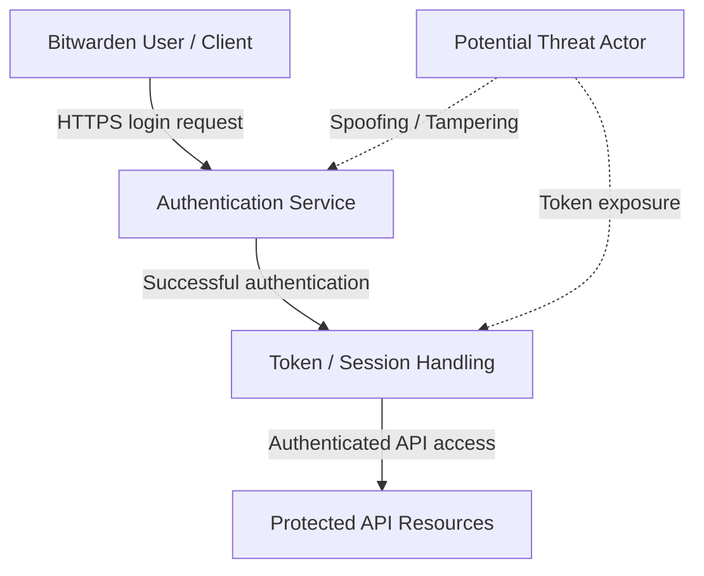

# Bitwarden Authentication and Session Security — STRIDE Threat Model

**Course:** CSCE 4565 — Secure Software Systems  
**Team Member:** Milesh Joshi  
**Project:** Bitwarden Security Assessment

## 1. Introduction

This threat model examines potential security threats affecting Bitwarden's authentication and session management processes. The purpose of this initial assessment is to identify possible attack scenarios, evaluate their security impact, and recommend appropriate mitigations using the STRIDE threat modeling framework.

The scope includes user authentication, credential verification, session token handling, and access to protected resources. This is a preliminary assessment, not a claim of confirmed Bitwarden vulnerabilities.

## 2. STRIDE Methodology

STRIDE identifies six categories of security threats: Spoofing, Tampering, Repudiation, Information Disclosure, Denial of Service, and Elevation of Privilege.

For this midterm assessment, five potential threats are analyzed, focusing on authentication and session security.

## 3. STRIDE Threat Analysis

### Threat 1: Spoofing — Unauthorized Account Access
- **Description:** An attacker may impersonate a legitimate Bitwarden user using stolen credentials obtained through phishing or credential theft.
- **Potential Impact:** Unauthorized account access and possible exposure of sensitive vault information, depending on additional protections.
- **Recommended Mitigation:** Multi-factor authentication, login rate limiting, and suspicious login detection.

### Threat 2: Tampering — Authentication Request Manipulation
- **Description:** An attacker may attempt to modify authentication requests or session-related data to bypass security checks.
- **Potential Impact:** Compromised authentication integrity and unauthorized actions.
- **Recommended Mitigation:** HTTPS/TLS, server-side request validation, and token integrity verification.

### Threat 3: Repudiation — Insufficient Authentication Logging
- **Description:** A malicious user may deny suspicious authentication activities if security logs are incomplete or unreliable.
- **Potential Impact:** Difficulty investigating unauthorized access or tracing suspicious activity.
- **Recommended Mitigation:** Protected authentication audit records and monitoring.

### Threat 4: Information Disclosure — Session Token Exposure
- **Description:** An attacker may obtain session tokens through compromised devices, insecure storage, or other exposure mechanisms.
- **Potential Impact:** A stolen valid token could enable session impersonation.
- **Recommended Mitigation:** Secure token storage, expiration, protected transmission, and session revocation.

### Threat 5: Elevation of Privilege — Authorization Bypass
- **Description:** An authenticated attacker may attempt to access resources or operations beyond their assigned permissions.
- **Potential Impact:** Unauthorized access to protected information or administrative functions.
- **Recommended Mitigation:** Server-side authorization checks, least privilege, and permission validation.

## 4. Preliminary Assessment

These threats highlight potential risks to authentication confidentiality, integrity, and accountability. Further source-code review and security testing are required to determine whether Bitwarden's existing controls adequately address them. No exploitable vulnerability has been confirmed.

## 5. STRIDE Threat Model Diagram

**Figure 1:** Conceptual Bitwarden Authentication and Session Security Threat Model.

The diagram illustrates a simplified authentication and session management process. The user communicates with the authentication service, session-related tokens support access to protected resources, and authorization checks protect API operations.

Potential attack surfaces include credential spoofing, request tampering, insufficient logging, session token exposure, and authorization bypass. The model is conceptual and requires validation against Bitwarden's source code.

## 6. Reference

Bitwarden. *Bitwarden Server Source Code*. https://github.com/bitwarden/server

**Assessment status:** Preliminary threat modeling only. No vulnerability testing has been performed as part of this contribution.
